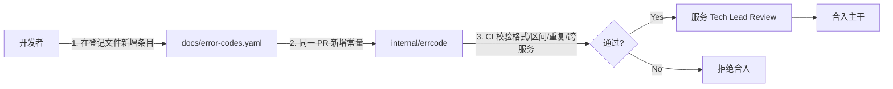

# 错误码系统规范

> 版本：V3.0.0-draft | 状态：草案 | 适用：Go + Gin 后端、前端（TS）
>
> 错误码格式、区间规则沿用 v2.1.0；**Go 用法改为公共库 `gin-go-common-lib/errors`（`AppError`）+ `response.FailErr`**，不再使用 `errno` / `xerror` SDK。HTTP 响应结构见 [api-doc.md](api-doc.md)。

---

## 1. 核心原则

* **先登记后使用**：错误码必须先写进本服务的错误码登记文件（§3），再在代码里引用
* **单一事实源**：每个服务的 `internal/errcode` 包是代码侧唯一出处，业务代码禁止在其他地方硬编码任何数字 / 字符串作为错误码
* **可定位优先**：仅凭错误码（如 `TRADE_ORDER_201`）即可定位到服务 `trade` / 模块 `order` / 类型 `资源不存在`
* **强契约**：CI 检查拦截硬编码、未登记、跨服务借用的错误码，不通过禁止合入


---

## 2. 错误码格式

### 2.1 标准格式

```
{SERVICE}_{MODULE}_{NNN}
```

| 段   | 定长  | 说明  | 取值示例 |
|-----|-----|-----|------|
| SERVICE | 3\~10 字符 | 服务名，与 MySQL 库名（业务域）对齐，全大写 | `TRADE` / `WALLET` / `AUTH` / `RISK` / `MARKET` / `COMMON` |
| MODULE | 3\~10 字符 | 领域模块，全大写 | `ORDER` / `BALANCE` / `KYC` / `WITHDRAWAL` |
| NNN | **固定 3 位** | 数字序号，范围 `001-999`，不足前导补零 | `001` / `042` / `201` |

### 2.2 NNN 区间规则

每个 `{SERVICE}_{MODULE}` 组合下，NNN 按错误类别划分区间，便于一眼识别错误语义：

| 区间  | 类别  | 建议 HTTP | 典型场景 |
|-----|-----|---------|------|
| `001-099` | 业务参数 / 校验失败 | 400     | 价格超限、参数缺失 |
| `100-199` | 认证 / 授权 / 权限 | 401 / 403 | Token 过期、权限不足 |
| `200-299` | 资源不存在 | 404     | 订单 / 用户 / 交易对不存在 |
| `300-399` | 状态冲突 / 并发 | 409     | 乐观锁冲突、状态机非法流转 |
| `400-499` | 频率 / 配额 / 限流 | 429     | 请求频率超限、提现超日限额 |
| `500-599` | 内部异常 / 外部依赖 | 500 / 502 / 503 | DB 异常、下游服务不可用 |
| `900-999` | 预留 / 自定义 | —       | 紧急通道、实验性 |

### 2.3 示例

| 错误码 | 类别  | HTTP | 含义  |
|-----|-----|------|-----|
| `TRADE_ORDER_001` | 业务校验 | 400  | 订单价格超出允许区间 |
| `TRADE_ORDER_002` | 业务校验 | 400  | 订单数量低于最小下单量 |
| `TRADE_ORDER_201` | 资源不存在 | 404  | 订单未找到 |
| `TRADE_ORDER_301` | 状态冲突 | 409  | 订单状态流转冲突（乐观锁） |
| `WALLET_BALANCE_001` | 业务校验 | 400  | 余额不足 |
| `WALLET_WITHDRAWAL_401` | 限流 / 配额 | 429  | 提现超过日限额 |
| `WALLET_ADDRESS_001` | 业务校验 | 400  | 链上地址无效 |
| `AUTH_TOKEN_101` | 认证  | 401  | Token 过期 |
| `AUTH_KYC_102` | 授权  | 403  | 未完成 KYC |
| `RISK_IP_101` | 授权  | 403  | IP 被风控拦截 |
| `MARKET_SYMBOL_001` | 业务校验 | 400  | 交易对已下架 |
| `COMMON_COMMON_401` | 限流  | 429  | 请求频率超限 |
| `COMMON_COMMON_501` | 内部异常 | 500  | 内部服务异常 |

### 2.4 反模式（禁用）

```
❌ 100404               // 纯数字，看不出业务
❌ ERR_001              // 无服务 / 无模块
❌ orderNotFound        // 大小写混用 / 无结构
❌ TRADE.ORDER.404      // 分隔符错误 / 混入 HTTP
❌ TRADE_ORDER_1        // NNN 未补零（应为 001）
❌ TRADE_ORDER_1001     // NNN 超过 3 位
❌ TRADE_ORDER_NOT_FOUND // 语义段应为数字
```


---

## 3. 先登记后使用 · 流程



1. **登记**：在服务仓库 `docs/error-codes.yaml` 新增条目（字段见 §4），NNN 在对应区间内从最小可用值递增，**不得回收已用号**
2. **定义**：同一个 PR 在 `internal/errcode` 中新增对应常量 / 构造函数（§5）
3. **CI 校验**：格式匹配 `^[A-Z]{3,10}_[A-Z]{3,10}_[0-9]{3}$`、NNN 落在区间内、登记文件无重复、`SERVICE` 段等于本服务名
4. **Review**：服务 Tech Lead 审批

### 3.1 禁止

* 边写代码边“自创”错误码，等合入后再补登记
* 直接 `errors.New("some message")` 或 `fmt.Errorf` 的结果当业务错误返回给 handler
* 跨服务借用（trade 代码中返回 `WALLET_*`，应定义 `TRADE_UPSTREAM_xxx`）
* 自选 NNN 跳过区间规则

---

## 4. 登记元数据

登记文件每条必填字段：

| 字段  | 必填  | 示例  |
|-----|-----|-----|
| code | ✓   | `TRADE_ORDER_201` |
| service | ✓   | `trade` |
| module | ✓   | `order` |
| category | ✓   | `NOT_FOUND`（对应 200-299 区间） |
| message_zh | ✓   | `订单未找到，请检查单号` |
| message_en | ✓   | `Order not found` |
| http_status | ✓   | `404` |
| level | ✓   | `WARN` / `ERROR` / `FATAL` |
| owner | ✓   | `trade-team` |
| deprecated | ✗   | 默认 `false` |

### 4.1 YAML 存储示例

```yaml
# docs/error-codes.yaml（trade 服务）
service: trade
codes:
  - code: TRADE_ORDER_001
    module: order
    category: VALIDATION
    message_zh: 订单价格超出允许区间
    message_en: Order price is out of the allowed range
    http_status: 400
    level: WARN
    owner: trade-team

  - code: TRADE_ORDER_201
    module: order
    category: NOT_FOUND
    message_zh: 订单未找到，请检查单号
    message_en: Order not found
    http_status: 404
    level: WARN
    owner: trade-team

  - code: TRADE_ORDER_301
    module: order
    category: CONFLICT
    message_zh: 订单状态流转冲突
    message_en: Order status transition conflict
    http_status: 409
    level: WARN
    owner: trade-team
```


---

## 5. Go 使用规范

### 5.1 定义（`internal/errcode`）

公共库 `errors.AppError` 含 `Code`（string）、`Msg`、`HTTPStatus`。通用错误（`COMMON_*` / `AUTH_*`）直接用公共库构造函数；**服务自己的业务错误在 `errcode` 包里集中定义**：

```go
// Package errcode 集中定义 trade 服务的业务错误码，是代码里唯一允许出现错误码字面量的地方。
package errcode

import "gin-go-common-lib/errors"

// 订单模块
func OrderPriceOutOfRange() *errors.AppError {
	return &errors.AppError{Code: "TRADE_ORDER_001", Msg: "order price is out of the allowed range", HTTPStatus: 400}
}

func OrderNotFound() *errors.AppError {
	return &errors.AppError{Code: "TRADE_ORDER_201", Msg: "order not found", HTTPStatus: 404}
}

func OrderStatusConflict() *errors.AppError {
	return &errors.AppError{Code: "TRADE_ORDER_301", Msg: "order status transition conflict", HTTPStatus: 409}
}
```

* 用**函数返回新实例**，不用包级 `var`：避免多处共享同一个指针被意外修改
* `HTTPStatus` 必须与 §8 的区间映射一致
* 错误 `Msg` 面向用户，**不得包含**内部细节（SQL、堆栈、下游地址）；排查信息写日志

### 5.2 使用

```go
// biz 层：返回业务错误，用 %w 包装保留错误链
order, err := uc.repo.GetByID(ctx, id)
if err != nil {
	if errors.Is(err) { // 已是 AppError，原样上抛
		return nil, err
	}
	return nil, fmt.Errorf("get order %s: %w", id, err)
}
if order == nil {
	return nil, errcode.OrderNotFound()
}

// handler 层：统一出口，自动按 AppError 映射 HTTP 状态码与业务码
if err != nil {
	response.FailErr(c, err)
	return
}
```

* 非 `AppError` 的 error 会被 `response.FailErr` 当作 `COMMON_COMMON_501`（HTTP 500）返回，且**不暴露原始 error 文本**；原始 error 必须在返回前由调用方记录日志（带 `trace_id`）
* data 层（repo）遇到 MySQL 错误，转换为业务可识别的错误再上抛：唯一键冲突（1062）→ 对应业务冲突码；死锁（1213）/ 锁等待超时（1205）→ 触发重试，重试仍失败返回 `COMMON_COMMON_501`
* 禁止在 handler 里手写 `response.Fail(c, "SOME_CODE", ...)` 传字面量；一律 `FailErr(c, errcode.Xxx())`

### 5.3 错误写法

```go
// ❌ 硬编码字符串 / 无错误码
return errors.New("order not found")

// ❌ 字面量错误码散落在业务代码
return &errors.AppError{Code: "TRADE_ORDER_201", Msg: "not found", HTTPStatus: 404}

// ❌ 跨服务借用
return walletcode.BalanceNotEnough()

// ❌ 把内部错误直接展示给用户
return errors.ErrInternal(err.Error())
```

---

## 6. CI 校验

CI 增加一步脚本（`scripts/check-errcode.sh` 或 Go 小工具），检查：

* `docs/error-codes.yaml` 中每个 `code` 匹配 `^[A-Z]{3,10}_[A-Z]{3,10}_[0-9]{3}$`，无重复，NNN 与 `category` 所属区间一致，`SERVICE` 段 = 本服务名
* `internal/errcode` 中出现的每个错误码都已登记（反之亦然）
* `internal/` 下 `errcode` 包**之外**不得出现形如 `"[A-Z]+_[A-Z]+_[0-9]{3}"` 的字符串字面量
* `internal/handler`、`internal/biz` 中不得出现 `errors.New(`（标准库）返回给上层作为业务错误

> 公共库目前没有现成的校验工具，上述脚本需要各服务（或在公共库）自行实现，本文只规定检查内容。

---

## 7. 可观测性联动

错误码结构化后，可以在日志 / Trace / Metrics 里直接按 `SERVICE` / `MODULE` / 区间过滤：

* **日志（Loki）**：错误日志自动携带 `error_code` 标签，例：

  ```
  {error_code=~"TRADE_ORDER_.*"}        # 订单模块全部错误
  {error_code=~".*_.*_[23][0-9]{2}"}     # 所有"不存在 / 冲突"类错误
  ```
* **Trace（Tempo）**：Span Attribute 注入 `error.code`，错误码直接下钻到染色链路
* **Metrics（VictoriaMetrics）**：按 `error_code` 聚合 counter；Grafana 额外配"错误类别分布"面板（按 NNN 区间分组）
* **告警**：`level=FATAL` 自动触发 PagerDuty；`5xx` 区间错误码按阈值聚合告警


---

## 8. HTTP 状态码映射建议

| HTTP | NNN 区间 | 示例  |
|------|--------|-----|
| 400  | 001-099 | `TRADE_ORDER_001` |
| 401  | 100-199 | `AUTH_TOKEN_101` |
| 403  | 100-199 | `AUTH_KYC_102` / `RISK_IP_101` |
| 404  | 200-299 | `TRADE_ORDER_201` |
| 409  | 300-399 | `TRADE_ORDER_301` |
| 429  | 400-499 | `WALLET_WITHDRAWAL_401` |
| 500  | 500-599 | `COMMON_COMMON_501` |


---

## 9. 维护与废弃

* **不可删除**：已注册错误码只能标记 `deprecated: true`，NNN 号不可回收复用
* **废弃回收**：`deprecated` 满 6 个月且代码中无引用，Tech Lead 确认后归档
* **旧数字码过渡**：v1 遗留纯数字码（如 `100404`）在迁移期内由网关映射为新格式，过渡期（建议 6 个月）后仅保留新格式


---

## 10. 审批与应急

| 操作  | 审批  |
|-----|-----|
| 新增错误码 | 服务 Tech Lead |
| 修改 message / http_status | 服务 Tech Lead |
| 标记 deprecated | 服务 Tech Lead + 架构组 |
| 紧急 Fast Track | Tech Lead + SRE 双签；先占用 900-999 区间，24h 内补齐登记元数据 |