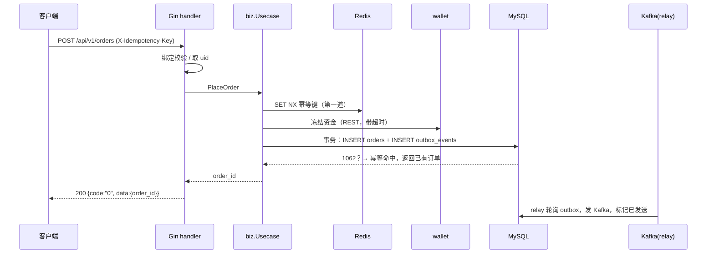

<!-- [skill: go-team-standards · 技术方案 · 数据库设计 · 接口规范] 订单服务技术方案范例 -->

# 订单服务技术方案（范例）

> 用途：这是一份**写技术方案的范例**，演示 10 个章节怎么组织、每章写到什么程度，并展示新技术栈下各规范如何落地。内容为虚构的“现货订单服务”，数值、阈值仅为示意，**不是真实业务设计**，照抄前须按自己的业务核对。
>
> 技术栈：Go 1.24 + Gin + MySQL 8.4 + Redis + Kafka，公共库 `gin-go-common-lib`。
>
> 写作要求：先写方案、评审通过再编码；评审关注点见 §10 末尾清单。引用的规范：[database.md](database.md)、[api-doc.md](api-doc.md)、[error-codes.md](error-codes.md)、[redis.md](redis.md)、[kafka.md](kafka.md)、[field-naming.md](field-naming.md)、[id-generation.md](id-generation.md)。

## 目录

1. 背景与概述
2. 目标与原则
3. 规范定义
4. 核心业务流程
5. 应用架构
6. 系统架构
7. 功能模块设计
8. 接口清单
9. 数据库设计
10. 边界与异常处理

---

## 1. 背景与概述

### 1.1 项目背景

> 写法：2–4 句，说清“现在有什么问题 / 为什么要做”，不写方案。

交易所现货交易需要一个独立的订单服务：接收用户委托、校验、冻结资金、投递撮合，并向下游（账户、通知、风控）广播订单状态变化。目前下单逻辑散落在网关内，无法独立扩容，也没有可靠的事件通知。

### 1.2 范围说明

| 范围 | 内容 |
|---|---|
| **包含** | 下单、撤单、订单查询、订单状态事件发布、成交回报落库 |
| **不包含** | 撮合算法（撮合引擎负责）、资金冻结的账务实现（`wallet` 服务负责）、行情推送 |
| **依赖** | `wallet`（冻结 / 解冻，REST）、撮合引擎（Kafka）、`auth`（网关鉴权） |

---

## 2. 目标与原则

### 2.1 业务目标

* 下单接口 P99 ≤ 100 ms（不含撮合）
* 订单状态事件**不丢、可重放**
* 同一笔委托无论客户端重试多少次，**只产生一个订单**

### 2.2 技术目标

| 目标 | 指标 |
|---|---|
| 可用性 | 99.95% |
| 下单峰值 | 3000 TPS（示意） |
| 一致性 | 订单与事件**最终一致**，订单状态以 MySQL 为准 |

### 2.3 设计原则

1. **MySQL 是唯一事实源**，Redis 只做缓存、限流、幂等第一道防线
2. **写库与发消息不在一个事务里，必须用 Outbox**（[kafka.md](kafka.md) §5）
3. **幂等优先**：所有写操作由 MySQL 唯一键兜底
4. **分层清晰**：`handler → biz → data`，biz 不依赖框架
5. **不引入第二套 ID / 时间 / 错误体系**：严格使用公共库与本团队规范

---

## 3. 规范定义

### 3.1 术语表

| 术语 | 含义 |
|---|---|
| Outbox | 与业务数据同事务写入的本地消息表，由 relay 异步投递到 Kafka |
| 幂等键 | `X-Idempotency-Key`（请求头）→ `client_order_id`（库内唯一键） |
| relay | 轮询 Outbox 并发送 Kafka 的后台进程 |

### 3.2 编码规范

* 代码风格见 [go-style.md](go-style.md)；分层、目录、依赖注入按其 §2、§6
* 业务错误统一 `errors.AppError`，在 `internal/errcode` 定义（[error-codes.md](error-codes.md) §5）

### 3.3 订单状态枚举

`order_status`（`TINYINT UNSIGNED`，`0` 保留）：

| 值 | 常量 | 含义 | 可流转到 |
|---|---|---|---|
| 1 | `OrderStatusPending` | 待撮合 | 2 / 3 / 4 |
| 2 | `OrderStatusPartiallyFilled` | 部分成交 | 3 / 4 |
| 3 | `OrderStatusFilled` | 完全成交 | — |
| 4 | `OrderStatusCanceled` | 已撤销 | — |
| 5 | `OrderStatusRejected` | 已拒绝 | — |

对外 JSON 用大写字符串（`PENDING` / `PARTIALLY_FILLED` / …），在 biz 层与整数互转。

### 3.4 Redis Key 规范

遵循 [redis.md](redis.md)，由 `naming.RedisKey` 构造：

| Key | 用途 | TTL |
|---|---|---|
| `trade:idem:{idempotency_key}` | 下单幂等第一道防线 | 24h |
| `trade:symbol:{symbol}` | 交易对配置缓存（精度、最小下单量） | 5–6 min（带抖动） |
| `trade:limit:{platform_id}:{uid}:place` | 用户下单限流计数 | 1s |

### 3.5 Kafka Topic 规范

遵循 [kafka.md](kafka.md)，由 `naming.TopicInProject` 构造：

| Topic | 方向 | 说明 |
|---|---|---|
| `prod_trade_order_status_updated` | 发布 | 订单状态变化，Key = `order_id` |
| `prod_matching_trade_matched` | 订阅 | 撮合成交回报 |
| `prod_trade_order_status_updated_dlq` | 死信 | 处理失败的消息 |

---

## 4. 核心业务流程

### 4.1 下单



关键点：

1. Redis 幂等只挡掉绝大多数重复；**真正的去重是 `orders` 表的唯一键** `(platform_id, uid, client_order_id)`
2. 冻结资金成功但落库失败 → 触发补偿解冻（见 §10.2）
3. 订单与 outbox 事件**同一个事务**提交

### 4.2 成交回报

撮合引擎发 `prod_matching_trade_matched` → 本服务消费 → 在**同一事务**内：写去重表 `consumed_events`、更新订单 `filled_qty` / `order_status`（乐观锁）、写 outbox 事件 → 提交后 relay 发 `order_status_updated`。

### 4.3 撤单

`POST /api/v1/orders/{id}/cancel`：校验状态可撤 → 乐观锁更新为已撤销 → 写 outbox → 异步通知撮合撤单 → 回调解冻。状态已是终态时视为幂等成功。

---

## 5. 应用架构

### 5.1 项目清单

| 项目 | 类型 | 职责 |
|---|---|---|
| `trade-service` | 服务 | 订单 API + 成交消费 + Outbox relay（同一进程内多 goroutine，或拆为独立 `-job`） |

### 5.2 项目结构

```
trade-service/
├── cmd/trade/main.go
├── configs/dev/server.yaml
├── migrations/
├── docs/{api, error-codes.yaml}
└── internal/
    ├── router/    — 路由与中间件装配（middleware.Default + idempotency）
    ├── handler/   — order_handler.go
    ├── biz/       — order.go（Usecase、状态机）、repository.go（接口）
    ├── data/      — order_repo.go（GORM）、cache.go（Redis）、outbox_repo.go
    ├── errcode/   — order.go
    ├── contract/  — order_event.go（Kafka 载荷）
    ├── job/       — outbox_relay.go、fill_consumer.go
    └── conf/
```

### 5.3 职责边界

| 层 | 允许 | 禁止 |
|---|---|---|
| handler | 绑定校验、取 `uid`、调用 usecase、`response.*` 输出 | 业务判断、直接访问数据库 |
| biz | 业务规则、状态机、事务边界、调用 repo 接口 | import gin / gorm / go-redis / kafka-go |
| data | SQL、缓存、Kafka 读写，实现 biz 的接口 | 业务规则 |

---

## 6. 系统架构

### 6.1 基础设施

| 组件 | 选型 | 说明 |
|---|---|---|
| 数据库 | MySQL 8.4（主从 + 半同步） | 库 `trade`；经 ProxySQL 接入 |
| 缓存 / 幂等 | Redis Cluster | 缓存实例与幂等 / 限流实例分开 |
| 消息 | Kafka | 副本 ≥ 3，`acks=all` |
| 可观测 | Prometheus + 日志 + Trace | `middleware.Default` 已含 TraceID / Logger / Metrics |

### 6.2 部署规范

* 容器化，至少 2 副本，滚动发布；健康检查 `/healthz`
* 配置：环境变量 + 配置文件；**密钥不入库**
* 连接池：MySQL ≤ 50 / 服务（[database.md](database.md) §2.3）

### 6.3 缓存分层

* 交易对配置：进程内 LRU（1 min）→ Redis（5 min）→ MySQL；回源用 `singleflight` 合并
* 订单详情：**不缓存**（强一致，直接读主库）

---

## 7. 功能模块设计

### 7.1 下单校验

校验顺序（越便宜越靠前）：参数格式 → 限流 → 幂等 → 交易对是否上架 → 价格 / 数量精度与区间 → 余额冻结。任何一步失败直接返回对应错误码，不进入下一步。

### 7.2 状态机

订单状态流转只允许 §3.3 表中的路径；非法流转返回 `TRADE_ORDER_301`。状态更新一律乐观锁：

```sql
UPDATE trade.orders
   SET order_status = ?, filled_qty = ?, version = version + 1, update_time = ?
 WHERE id = ? AND version = ?;
```

`RowsAffected = 0` → 版本冲突，重读重试（最多 3 次），仍冲突返回 `TRADE_ORDER_301`。DSN 已开 `clientFoundRows=true`。

### 7.3 Outbox relay

* 每 200ms 取 `event_status = 1`（待发送）的记录，批量 ≤ 100，按 `create_time` 排序
* 多实例用 `FOR UPDATE SKIP LOCKED`，同一 `msg_key` 串行发送
* 发送成功标记 `2`；失败 `retry_count + 1`，指数退避；超过 10 次标 `3` 并告警

---

## 8. 接口清单

遵循 [api-doc.md](api-doc.md)。以下为清单，每个接口的详细文档按模板写在 `docs/api/`。

| 接口 | 方法 | 路径 | 幂等 | 说明 |
|---|---|---|---|---|
| 下单 | POST | `/api/v1/orders` | `X-Idempotency-Key` | 返回 `order_id` |
| 撤单 | POST | `/api/v1/orders/{id}/cancel` | 状态幂等 | |
| 订单详情 | GET | `/api/v1/orders/{id}` | — | 读主库 |
| 订单列表 | GET | `/api/v1/orders` | — | 页码 / 游标；过滤 `symbol`、`order_status`、`create_time_start/end` |

### 8.1 下单（示例）

请求体：

```json
{ "symbol": "BTC-USDT", "order_side": "BUY", "order_type": "LIMIT", "price": "65000.00", "quantity": "0.5" }
```

成功响应 `data`：`{ "order_id": "0194f3a2-7c1e-7b52-9d0a-3f6c2e8a1b45" }`

| 错误码 | HTTP | 触发 |
|---|---|---|
| `COMMON_COMMON_002` | 400 | 参数校验失败 |
| `TRADE_ORDER_001` | 400 | 价格超出允许区间 |
| `TRADE_ORDER_002` | 400 | 数量低于最小下单量 |
| `TRADE_SYMBOL_001` | 400 | 交易对已下架 |
| `TRADE_ORDER_003` | 400 | 余额不足（`wallet` 返回后由本服务转换，见 §10.1） |
| `COMMON_COMMON_301` | 409 | 重复请求 |
| `COMMON_COMMON_401` | 429 | 下单过于频繁 |

---

## 9. 数据库设计

遵循 [database.md](database.md)。库 `trade`，字符集 `utf8mb4` / `utf8mb4_0900_bin`。

### 9.1 表清单

| 表 | 类型 | 说明 |
|---|---|---|
| `trade.orders` | 核心业务表 | 订单 |
| `trade.order_fills` | 核心业务表 | 成交明细 |
| `trade.outbox_events` | 核心业务表 | 本地消息表（DDL 见 [kafka.md](kafka.md) §5） |
| `trade.consumed_events` | 核心业务表 | 消费去重表（DDL 见 [kafka.md](kafka.md) §4.1） |

### 9.2 订单表 DDL

```sql
CREATE TABLE `trade`.`orders` (
    `id`               BINARY(16)       NOT NULL COMMENT '主键 UUIDv7，应用层 idgen 生成；对外即 order_id',
    `platform_id`      VARCHAR(32)      NOT NULL COMMENT '平台 ID',
    `uid`              VARCHAR(64)      NOT NULL COMMENT '用户 ID',
    `client_order_id`  VARCHAR(64)      NOT NULL COMMENT '客户端订单号，幂等键',
    `symbol`           VARCHAR(40)      NOT NULL COMMENT '交易对 BASE-QUOTE',
    `order_side`       TINYINT UNSIGNED NOT NULL COMMENT '方向：1=买 2=卖',
    `order_type`       TINYINT UNSIGNED NOT NULL COMMENT '类型：1=限价 2=市价',
    `price`            DECIMAL(38,18)   NOT NULL COMMENT '委托价',
    `quantity`         DECIMAL(38,18)   NOT NULL COMMENT '委托数量',
    `filled_qty`       DECIMAL(38,18)   NOT NULL DEFAULT 0 COMMENT '已成交数量',
    `order_status`     TINYINT UNSIGNED NOT NULL DEFAULT 1 COMMENT '状态：1=待撮合 2=部分成交 3=完全成交 4=已撤销 5=已拒绝',
    `version`          INT UNSIGNED     NOT NULL DEFAULT 0 COMMENT '乐观锁版本号',
    `create_time`      BIGINT UNSIGNED  NOT NULL COMMENT '创建时间，毫秒时间戳（UTC），应用层写入',
    `update_time`      BIGINT UNSIGNED  NOT NULL COMMENT '更新时间，毫秒时间戳（UTC），每次更新必写',
    `created_at`       TIMESTAMP        NOT NULL DEFAULT CURRENT_TIMESTAMP COMMENT '创建时间',
    `updated_at`       TIMESTAMP        NOT NULL DEFAULT CURRENT_TIMESTAMP ON UPDATE CURRENT_TIMESTAMP COMMENT '更新时间',
    PRIMARY KEY (`id`),
    UNIQUE KEY `uk_orders_platform_uid_client_order` (`platform_id`, `uid`, `client_order_id`),
    KEY `idx_orders_platform_uid_ctime` (`platform_id`, `uid`, `create_time` DESC),
    KEY `idx_orders_platform_symbol_status` (`platform_id`, `symbol`, `order_status`),
    CONSTRAINT `ck_orders_positive_qty` CHECK (`quantity` > 0),
    CONSTRAINT `ck_orders_filled_qty` CHECK (`filled_qty` >= 0 AND `filled_qty` <= `quantity`)
) ENGINE=InnoDB DEFAULT CHARSET=utf8mb4 COLLATE=utf8mb4_0900_bin ROW_FORMAT=DYNAMIC COMMENT='现货订单表';
```

### 9.3 设计说明

* 无外键、无软删除、无自增主键；`id` 由应用层 UUIDv7 生成
* 幂等由唯一键 `uk_orders_platform_uid_client_order` 保证；命中 1062 视为重复，查出已有订单返回
* `order_fills` 同样按规范建表，按 `order_id` + `create_time` 建索引；超 2000 万行后按 `create_time` 月分区（分区表的主键须包含 `create_time`，见 [database.md](database.md) §5.1）
* 容量估算：单行约 250 B，3000 TPS 峰值、日均 500 万单 → 年约 18 亿行，**必须分区并规划归档**（2 年在线）

### 9.4 Migration

* 工具 `goose`；文件 `migrations/000001_trade_create_orders.up.sql` / `.down.sql`
* 新表需 DBR 评审（[database.md](database.md) §6.5）

---

## 10. 边界与异常处理

### 10.1 下游异常

| 场景 | 处理 |
|---|---|
| `wallet` 超时 / 5xx | 超时 800ms，重试 1 次；仍失败返回 `COMMON_COMMON_502`，**不落库** |
| `wallet` 返回余额不足 | 转换为本服务错误码返回，**不透传下游错误码**（避免跨服务借用） |
| Redis 不可用 | 幂等第一道防线放行（公共库 fail-open），依赖 MySQL 唯一键；限流降级为网关限流 |
| MySQL 主库不可用 | 返回 `COMMON_COMMON_501`；不降级读从库做写 |

### 10.2 一致性与补偿

| 场景 | 处理 |
|---|---|
| 冻结成功、落库失败 | 记录补偿任务，异步解冻；解冻幂等（按 `client_order_id`） |
| Outbox 发送失败 | 退避重试；超限告警人工处理 |
| 消费重复 | `consumed_events` 唯一键命中 1062 → 视为成功 |
| 消费处理失败 | handler 内重试 3 次后写 `_dlq` 并告警（不依赖返回 error，见 [kafka.md](kafka.md) §4.2） |
| 乐观锁冲突 | 重读重试 3 次，仍失败返回 `TRADE_ORDER_301` |

### 10.3 监控与告警

* 指标：下单 QPS / P99、各错误码计数、Outbox 积压条数、消费 lag、DLQ 堆积
* 告警：Outbox 待发送 > 1000 持续 1 分钟；DLQ 有新消息；P99 > 300 ms；MySQL 复制延迟 > 1 s
* 日志：带 `trace_id`、`uid`、`order_id`；**不记录**完整请求体

### 10.4 评审清单

- [ ] 范围 / 目标 / 不做什么 已写清
- [ ] 流程图覆盖正常 + 失败 + 补偿
- [ ] 接口按 [api-doc.md](api-doc.md) 模板，错误码已登记
- [ ] 表结构通过 [database.md](database.md) DBR 清单（必备字段、唯一键、索引、容量估算、分区）
- [ ] 写库 + 发消息使用 Outbox；消费端有去重表与 DLQ
- [ ] Redis 只做缓存 / 幂等 / 限流，资金正确性不依赖 Redis
- [ ] 所有外部调用有超时与降级策略
- [ ] 监控与告警项已列
